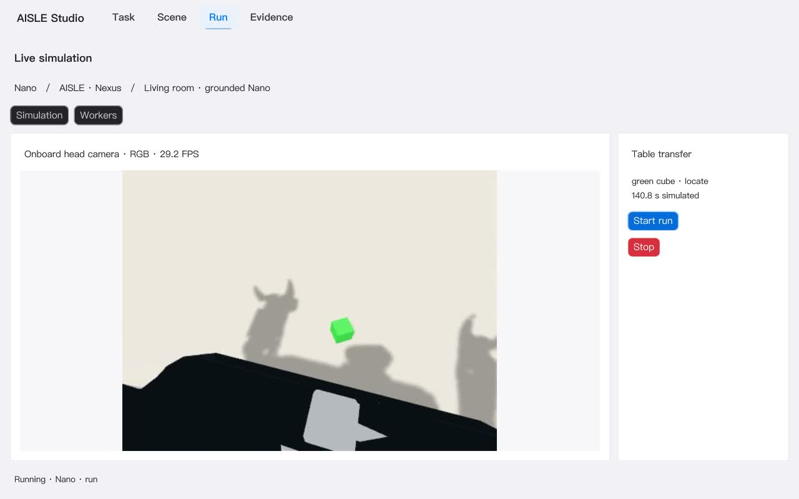

# AISLE Studio

AISLE Studio is a standalone Makepad application for developing robot tasks with AISLE and Nexus. It opens directly to Task, with Scene, Run and Evidence in the same window. Adora Nano and Unitree G1 are the reference robots.

[](media/nano-three-cubes-3x.mp4)

[Watch the standalone app at 3× speed](media/nano-three-cubes-3x.mp4). Codex prepared the red, green, blue transfer and Nexus verified all three cubes settled on the coffee table. The 1 min 55 s recording shows the full app from Task through Evidence. [Run measurements](media/nano-three-cubes.json)

## Run locally

The tested setup uses an Apple Silicon Mac, Rust, Python 3.13, uv, FFmpeg with development headers, and a GPU supported by Nexus. From this repository:

```sh
git clone https://github.com/moxin-org/AISLE.git ../aisle-workbench-runtime
git -C ../aisle-workbench-runtime checkout --detach dbd34a71b6f82a011541b433306ca7e6a705e823
export DOROBOT_AISLE_ROOT="$(cd ../aisle-workbench-runtime && pwd)"
uv venv --python 3.13 .venv-aisle
uv pip install --python .venv-aisle/bin/python numpy==2.5.5 pillow==13.0.0 dimforge-nexus3d==0.2.1 pyarrow==26.0.1 pyyaml==6.0.3 opencv-python-headless==5.1.0.95 scipy==1.18.1
python3 tools/fetch_robot_meshes.py g1
cargo run --locked --bin aisle-studio
```

Select **Use reference task** to inspect a shoulder without an authoring service. **Ask Codex** uses the authenticated Codex CLI. **DeepSeek via Octos** uses an installed Octos CLI with a configured DeepSeek profile. The selected author prepares the task program. The local simulation controller reads sensors and issues bounded motor commands.

1. On **Task**, select Nano or G1 and prepare a controller.
2. On **Scene**, inspect the model, choose a layout or adjust simulation conditions.
3. On **Run**, start the selected program and watch the live camera and feedback.
4. On **Evidence**, inspect the verdict, export a LeRobot episode, or open the exported episode in Replay.

By default, sessions live in `~/Library/Application Support/AISLE Studio/aisle` on macOS and `~/.local/share/aisle-studio/aisle` on Linux. `DOROBOT_STUDIO_STATE_DIR` isolates a session. `DOROBOT_AISLE_PYTHON` selects an existing Python environment.

To repeat a saved experiment on another Mac, select the registered worker under **Run → Repeat experiment**. Studio checks its robot model, shows its available slots, and imports the measured trial when the lease finishes. [Worker setup, cancellation and recovery](docs/product/aisle-studio/environment/experiments.md#run-on-a-registered-worker)

To run a prepared controller through an installed Octos skill, use **Task → Skill library**. Choose the source and version, prepare the task, then use **Run**. Evidence records the bridge request and the package that actually executed. [Install and verify the SPEC bridge](docs/product/aisle-studio/environment/spec-skills.md)

## Verify the windowless app

With the workspace built and the runtime configured, run the native smoke check from a fresh session. It selects G1, inspects its reference shoulder movement in Nexus, exports the episode, opens Replay and verifies that Evidence restores the same trial on restart.

```sh
python3 tools/check_headless.py --studio target/debug/aisle-studio \
  --remote "$(command -v makepad-remote)" --session /tmp/aisle-g1-smoke
```

For the complete Survey, Scene, Task, Run and Evidence workflows, submit the native suite to a registered Makepad DevHub worker. A separate focused job exercises both authenticated photo-review providers. [DevHub commands and qualification](docs/product/aisle-studio/environment/devhub/README.md)

## Screen recording

Build `makepad-remote` from the same Makepad revision as `Cargo.lock`. To record a fresh Codex-authored three-cube transfer, run the following in the environment above. Choose a new session directory and output filename for each take.

```sh
python3 tools/record_demo.py --studio target/debug/aisle-studio \
  --remote "$(command -v makepad-remote)" --session /tmp/aisle-nano-demo \
  --output /tmp/aisle-nano-3x.mp4
```

The recorder captures the complete app window with no desktop window visible. Makepad’s `offscreen` backend provides rendered pixels. Its `headless` backend is available for input and state checks. The recorder uses elapsed wall time for 3× playback, including controller preparation, simulation, and the final Evidence page.

## Product and provenance

The native executable, navigation and session storage belong to this repository. The four robotics pages, Nexus worker, model assets and shared UI libraries were extracted from [the validated source revision](https://github.com/dorobot-org/dorobot-studio/tree/e490c9f73ce2a6d63416880e33305cfbdcc50a2b). The asset directories retain their provenance records. The original integration PR is independent of this repository.

[Product requirements](docs/product/aisle-studio/PRD.md) · [Design review and generated screens](docs/product/aisle-studio/design-review.md) · [AISLE runtime](https://github.com/moxin-org/AISLE)
