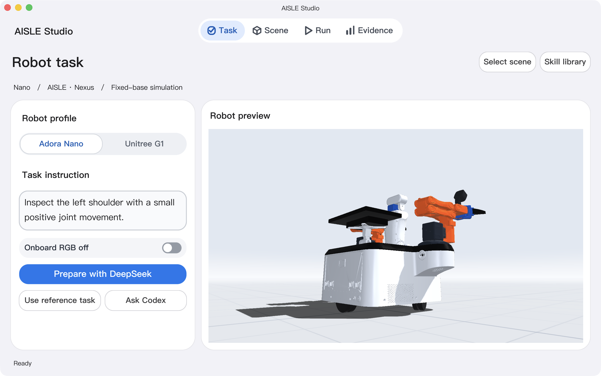

# AISLE Studio navigation review

**95/100** in the November 25, 2026 internal Codex review of the implemented Mac app. The review covers 18 native screenshots at 1024 × 768 and 1440 × 900 logical points. The score is a visual judgment against the ten product criteria. The review did not include a participant usability study or testing on an iPhone or iPad. [Product requirements](../../PRD.md#design-and-release-gates)

## Navigation

The four tabs answer four operator questions. **Task** defines what the robot should do. **Scene** shows the robot and its environment. **Run** executes a controller. **Evidence** holds the results. Their order and labels stay fixed. The selected tab has a blue background, an icon and a text label. Click a tab or use ⌘1 through ⌘4 in that order. Returning to Task restores the operator’s place.

The design borrows the top tab bar from regular-width iPadOS. Robot, sensing and controller choices sit with the task they configure. The generated first-launch concept pairs that form with a Nano preview. The actual app renders the URDF. [Generated concept](concept.png) · [Apple tab bar guidance](https://developer.apple.com/design/human-interface-guidelines/tab-bars) · [Apple’s regular-width iPad tab layout](https://developer.apple.com/documentation/uikit/elevating-your-ipad-app-with-a-tab-bar-and-sidebar)

## Implemented UI score

| Product criterion | Points | Review observation |
| --- | ---: | --- |
| Shell consistency | 10 | The same four labeled tabs keep the same position across all nine views at each size. The active destination stays visible in deeper modes. [Scene editor](populated/scene-1024.png) |
| Page identity | 10 | Page headings identify the work in view. “Repeat experiment” and “Experiment trials” distinguish configuring another run from inspecting an earlier trial. [Run](populated/run-1440.png) · [Evidence](populated/evidence-1440.png) |
| Next-action clarity | 10 | First launch gives preparation one primary button. An empty Run or Evidence offers “Open Task”. After controller preparation, empty Evidence offers “Open Run”. [Task](navigation-offscreen/task-1024.png) · [Empty Run](navigation-offscreen/run-1024.png) · [Tested routes](navigation/verification.json) |
| Robot identity | 9 | Task names both robots, marks the selection and displays its model. In trial history, the robot name shares a small metadata line with the scene and seed. [Task](navigation-offscreen/task-1440.png) · [Trial history](populated/evidence-1024.png) |
| Simulation context | 10 | Task and Scene name Nexus and the fixture condition. The editor shows authored geometry, Survey shows the source photo, and trial replay identifies the head camera and measured physics steps. [Scene](navigation-offscreen/scene-1024.png) · [Survey](populated/survey-1440.png) · [Replay](populated/evidence-1440.png) |
| State visibility | 9 | The selected tab, robot, RGB state and run outcome are visible. A cancelled repetition is recorded in batch history, but its status has little visual emphasis alongside completed rows. [Task](navigation-offscreen/task-1024.png) · [Batch history](populated/run-1024.png) |
| Task and result separation | 10 | Task names the cube to grasp and the receiving surface. Evidence separately shows the recorded camera frame, measurements and operator notes. [Bindings](populated/task-1024.png) · [Trial evidence](populated/evidence-1024.png) |
| Typography and readability | 9 | Page titles, tabs and setup actions have a clear hierarchy. The text in the narrow replay inspector is small, especially its run identifiers. [Replay inspector](populated/evidence-1024.png) |
| Grouping and spacing | 9 | The form and preview have distinct surfaces. Local modes stay together. The narrow scene editor leaves limited space for small objects when the full room is visible beside the inspector. [Task](navigation-offscreen/task-1024.png) · [Full-room editor](populated/scene-1024.png) |
| Artifact discoverability | 9 | Evidence is always one tab away. Survey exposes the photo strip and replay lists recording files. At 768 points tall, the recording and variant controls extend below the visible inspector. [Survey](populated/survey-1024.png) · [Trial evidence](populated/evidence-1024.png) |
| **Total** | **95/100** | The implemented desktop navigation meets the 95-point product gate. |

## Native captures

| View | 1024 × 768 | 1440 × 900 |
| --- | --- | --- |
| First launch · Task | [Compact](navigation-offscreen/task-1024.png) | [Wide](navigation-offscreen/task-1440.png) |
| First launch · Scene | [Compact](navigation-offscreen/scene-1024.png) | [Wide](navigation-offscreen/scene-1440.png) |
| First launch · Run | [Compact](navigation-offscreen/run-1024.png) | [Wide](navigation-offscreen/run-1440.png) |
| First launch · Evidence | [Compact](navigation-offscreen/evidence-1024.png) | [Wide](navigation-offscreen/evidence-1440.png) |
| Bind a scene task | [Compact](populated/task-1024.png) | [Wide](populated/task-1440.png) |
| Edit a scene | [Compact](populated/scene-1024.png) | [Wide](populated/scene-1440.png) |
| Survey photos and assets | [Compact](populated/survey-1024.png) | [Wide](populated/survey-1440.png) |
| Repeat an experiment | [Compact](populated/run-1024.png) | [Wide](populated/run-1440.png) |
| Replay a trial | [Compact](populated/evidence-1024.png) | [Wide](populated/evidence-1440.png) |

## Verification

Makepad DevHub job **J31**, lease **L1032**, completed on the registered macOS worker `aisle-local` in 43 seconds with exit code 0. It built revision `71e55feda18c6b6a1ab5e9ac26e2a1b705e7b98e` with locked dependencies and checked its executable digest after both runs. [Worker manifest and receipt hashes](devhub.json)

- **Pointer and keyboard.** All four tabs had a 44-point height, non-overlapping bounds and a combined center within two points of the window center. Eight first-launch Task actions were also at least 44 × 44 points. The suite exercised ⌘1–4, stable repeated mode selection, Nano/G1 switching, RGB selection, returning to scene binding and the empty-project preparation flow. [Headless input measurements](navigation/verification.json)
- **Rendered output.** The pixel checks found a blue selected tab at each destination, dark heading glyphs on white Scene and Run cards, and Nano’s orange arm meshes inside both Task and Scene viewports at both sizes. [Offscreen measurements](navigation-offscreen/verification.json)
- **Populated workflows.** A separate native pass opened saved survey, scene, repeat-experiment and replay data and checked the main control bounds at both sizes. A local G1 smoke test prepared a reference controller, ran a scored Nexus simulation, exported the episode, replayed it and reopened the session. [Recorded workflow bounds](populated/window-sizes.json) · [G1 smoke test](../../../../../tools/check_headless.py)
- **Reproduction.** Follow the DevHub setup and append `--suite navigation` to the worker’s Python command. The offscreen run uses the AISLE Python environment with Pillow installed. Use the window-size script with saved survey, experiment and evidence sessions to reproduce the populated views. [Worker setup](../devhub/README.md) · [Navigation test](../../../../../tools/check_navigation.py) · [Populated capture script](../../../../../tools/check_environment_sizes.py)
