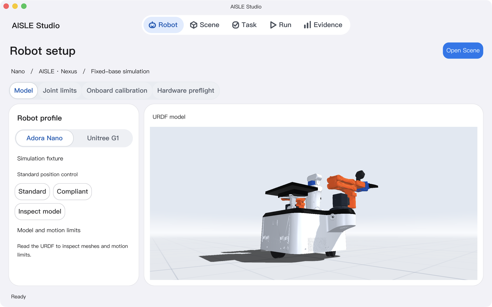

# Robot-first navigation in AISLE Studio

**Robot → Scene → Task → Run → Evidence** follows what an operator needs to know before acting. A fresh workspace opens on Robot. A saved workspace reopens on its last valid tab. Click a tab or use ⌘1 through ⌘5. [Running Mac window](desktop.png) · [Generated design reference](concept.png)

## What belongs where

| Tab | Operator action | What follows it |
| --- | --- | --- |
| Robot | Select Nano or G1. Inspect the URDF, joint limits and fixture. In **Onboard calibration**, import Nano’s head and wrist camera survey. In **Hardware preflight**, check a supported adapter against a successful simulation trial. | **Open Scene** takes the active robot into environment setup. A prepared Nano controller retains its camera profile when the operator clears or replaces the active calibration. |
| Scene | Create or select the room. Arrange assets, set physical properties, and open **Room registration** in the inspector to set the robot start and fixed room cameras. | Save a revision and select **Create task** to bind objects in that revision. **Open Task** also lets an operator use a built-in reference task. |
| Task | Choose the scene targets and perception inputs, then prepare the controller with DeepSeek, Codex or the built-in reference. | **Open Run** appears when the prepared controller matches the active scene binding and the operator has left the binding editor. |
| Run | Review readiness, start or repeat a Nexus simulation, monitor measurements or stop it. | **Review robot** and **Review scene** take the operator back to the corresponding settings. |
| Evidence | Inspect the measured outcome, replay the trial, export an episode or examine **Preflight results**. | The saved result retains its controller, scene and measurement provenance. |

### Coordinate frames

An onboard camera mount belongs to a robot link. The Nano import accepts a camera survey JSON file or the camera calibration entry in an older combined room survey. Studio checks the model hash, fits the mounts and stores the active profile in the workspace. The profile travels with newly prepared controllers. Older room revisions remain readable. [Measured onboard calibration](navigation-offscreen/nano-calibration.png) · [Optics read back from Nexus](measured-optics.json)

Scene registration uses metres and degrees. Enter the robot’s X, Y and counterclockwise heading relative to the room. Enter one named fixed camera per line with X, Y, Z, roll, pitch and yaw in the room frame. Apply the registration, then save a scene revision. Nexus compiles the room geometry into the robot’s start frame. Fixed-camera poses are stored with the scene and exposed in trial evidence. This release exercises the Nano’s onboard RGB feeds and read-only hardware preflight. Fixed-camera live acquisition and physical robot motion were outside this test. [Room registration in the editor](navigation-offscreen/room-registration.png) · [Registered Nano trial](nano-physics.json) · [Registered G1 trial](g1-physics.json)

## Native UX review

**95/100** in the internal Codex review of the running Mac app. The score uses the ten criteria in the product requirements. The review covered ten fresh-project screenshots and ten populated workflow screenshots at two desktop sizes, plus the calibration and registration screens. Participant usability testing has not been conducted. [Product requirements](../../PRD.md#design-and-release-gates)

| Criterion | Points | Observation |
| --- | ---: | --- |
| Shell consistency | 10 | All five labeled tabs stay in the same order and place throughout setup, execution and replay. Both native backends exercised pointer input and all five shortcuts. |
| Page identity | 10 | Robot model, joint limits, onboard calibration and adapter checks have names under Robot. Environment geometry and room-frame registration are under Scene. Hardware outcomes are labeled “Preflight results” in Evidence. |
| Next-action clarity | 10 | A new operator can continue directly from Robot to Scene. A saved revision offers Create task, a prepared matching task offers Open Run, and an empty Run links back to preparation. |
| Robot identity | 9 | Setup names and depicts the selected model. In populated trial history, the robot name shares a small metadata line with the scene and seed. |
| Simulation context | 10 | The Robot and Run pages name Nexus. Scene distinguishes the source photo, authored geometry and robot-start marker. Robot labels the hardware adapter check as read-only. |
| State visibility | 9 | Selection, active robot, missing controller, measured camera fits and scene save state are visible. A cancelled batch row has little visual distinction from a completed row. |
| Task and result separation | 10 | Binding and authoring belong to Task. Run owns execution. Evidence separately exposes the recorded frames, metrics and notes. |
| Typography and readability | 9 | Titles, destinations and setup actions are legible at both widths. Run IDs and detailed replay metadata are small in the compact inspector. |
| Grouping and spacing | 9 | The robot’s settings sit beside its model. On a compact window, showing the whole room and its inspector leaves small scene objects hard to distinguish. |
| Artifact discoverability | 9 | Evidence opens from every tab and names the available recordings. Some recording and variant controls still require scrolling in the compact inspector. |
| **Total** | **95/100** | Meets the internal desktop UX gate. |

| Native view | 1024 × 768 | 1440 × 900 |
| --- | --- | --- |
| Robot setup | [Compact](navigation-offscreen/robot-1024.png) | [Wide](navigation-offscreen/robot-1440.png) |
| New scene | [Compact](navigation-offscreen/scene-1024.png) | [Wide](navigation-offscreen/scene-1440.png) |
| Task preparation | [Compact](navigation-offscreen/task-1024.png) | [Wide](navigation-offscreen/task-1440.png) |
| Run readiness | [Compact](navigation-offscreen/run-1024.png) | [Wide](navigation-offscreen/run-1440.png) |
| Empty evidence | [Compact](navigation-offscreen/evidence-1024.png) | [Wide](navigation-offscreen/evidence-1440.png) |
| Photo survey | [Compact](populated/survey-1024.png) | [Wide](populated/survey-1440.png) |
| Saved room | [Compact](populated/scene-1024.png) | [Wide](populated/scene-1440.png) |
| Task binding | [Compact](populated/task-1024.png) | [Wide](populated/task-1440.png) |
| Repeat experiment | [Compact](populated/run-1024.png) | [Wide](populated/run-1440.png) |
| Trial replay | [Compact](populated/evidence-1024.png) | [Wide](populated/evidence-1440.png) |

## Verification

- **Makepad.** Job **J33**, lease **L1034** on the registered macOS worker, passed in 62 seconds. The DevHub navigation suite builds the locked revision and checks the same executable using headless input and offscreen rendering. It exercises all five tabs, 44-point tab targets, shortcuts, matching controller handoff, measured calibration import, saved registration, restart and fallback from an unknown saved destination. [Worker manifest](devhub.json) · [Input receipt](navigation/verification.json) · [Rendered receipt](navigation-offscreen/verification.json) · [Populated control bounds](populated/window-sizes.json)
- **Nano.** Each camera mount used nine fit points and five separate check points. The largest check error was 0.70 pixels. A fresh Nexus observation used all three imported poses and intrinsics. A separate registered-room trial using the default optics successfully transferred one red cube to the tabletop. [Calibration readback](measured-optics.json) · [Pickup and measured room transform](nano-physics.json)
- **G1.** The registered-room standing-reach task completed 2,000 steps under its bounded-impact fixture and stayed within joint limits. Both robots’ measured floor translations and rotations matched the expected room-to-robot transform. A separate native flow exercised reference preparation, execution, episode export, replay and restart. [G1 measurements](g1-physics.json) · [Native end-to-end check](../../../../../tools/check_headless.py)
- **Reproduction.** Submit the documented DevHub command with `--suite navigation`. The measured camera fixture ships in this repository. Frame compilation also has a regression test that turns the starting heading by 90 degrees and checks every body. [DevHub setup](../devhub/README.md) · [Navigation suite](../../../../../tools/check_navigation.py) · [Scene transform regression](../../../../../tools/aisle_workbench/test_authored_scene.py)
