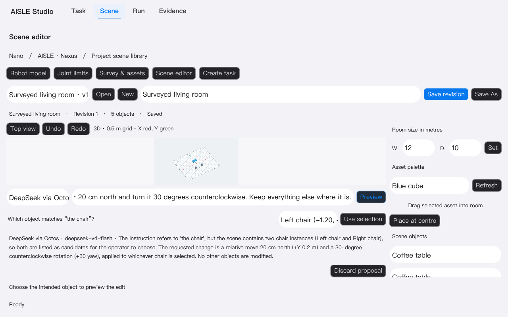
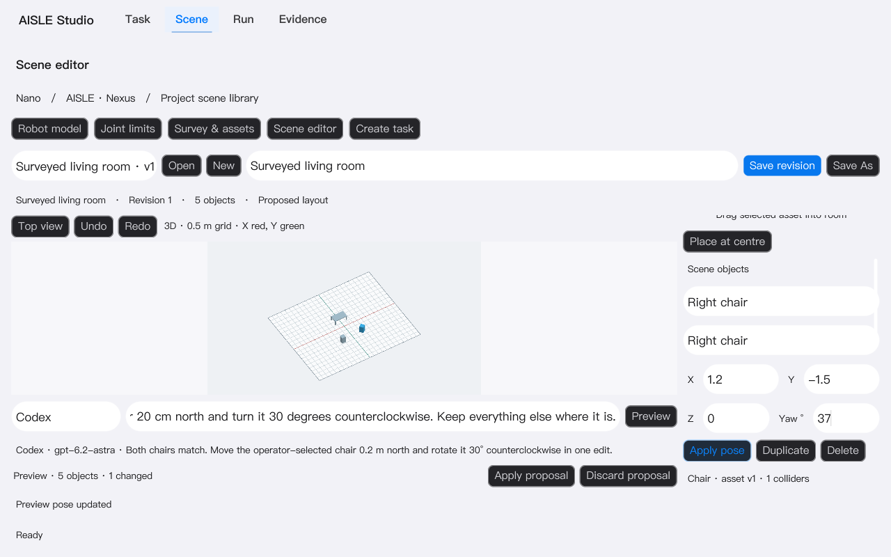

# Compose a versioned scene in AISLE Studio

Open **Scene → Scene editor**. Start from **New** or select a saved scene and choose **Open**. Enter the room width and depth in metres and choose **Set**. The grid is spaced every half metre. Switch between the 3D and top views to inspect clearance or place objects in plan.

- **Place an asset.** Select it in the palette and drag the strip immediately below the selection into the viewport. **Place at centre** adds it at the origin. Use **Refresh** after adding a new asset in Survey & assets.
- **Compose from a request.** With coffee table and chair assets in the library, enter “Place one coffee table and two chairs in the room” and choose **Preview**. Inspect the proposed objects and choose **Apply proposal** or **Discard proposal**. Select **Local commands** for quantities, exact names and requests such as “Move the left chair beside the ottoman.” Select **Codex** or **DeepSeek via Octos** for compound edits and an interactive object choice.
- **Adjust an instance.** Select its rendered collider or choose its name under **Scene objects**. Drag it on the floor plane, or enter a position in metres and a yaw in degrees and choose **Apply pose**. **Duplicate**, **Delete**, **Undo** and **Redo** operate on instances. With the viewport focused, the arrow keys select an instance, Delete removes it and Command-Z restores the previous layout.
- **Check or snap.** In the inspector, choose the floor or a named placement surface and choose **Snap**. The editor checks each pinned asset’s colliders for overlaps, room boundaries, floor penetration, missing scale and broken placement surfaces. **Inspect issue** selects an affected object. Pinning an unfinished asset leaves its position visible as a cross.
- **Save or fork.** Give the scene a name and choose **Save revision**. Later saves preserve the previous snapshots. To create a separate scene, change the name and choose **Save As**. The variant records its source scene and revision. Reopen the original from the scene library.

[Native proposal preview](scene-verification/proposal.png) · [Five placed instances](scene-verification/five-instances.png)

## Review an agent edit

1. Open a saved room with two chair instances. Choose **Codex** or **DeepSeek via Octos** in the scene editor. Enter “Shift the chair 20 cm north and turn it 30 degrees counterclockwise. Keep everything else where it is.” Choose **Preview**.
2. Studio sends the agent the instruction, room dimensions, asset names and revisions, named surfaces, and the names, identities and current poses of authored instances. It validates the returned operations against that library. Choose **Right chair** and **Use selection** when Studio asks which chair you meant. Either chair may reference the same library asset.
3. Inspect the selected object’s X, Y, Z and yaw. The preview moves the right chair from Y = −1.70 m to −1.50 m and turns it 30°. To adjust the proposal, enter 37° in **Yaw** and choose **Apply pose**. **Discard proposal** restores the working layout. **Apply proposal** accepts all reviewed changes together. **Undo** and **Redo** include the recorded authorship.
4. Choose **Save revision** and reopen the scene. The revision stores the provider, model, instruction, request and reply digests, selected identities, proposed operations and IDs adjusted during review. The earlier revision remains available for comparison. Bind the saved revision in **Task** to run it in Nexus.





The agent may propose adding catalog assets, translating or rotating an instance, setting a pose, positioning an instance relative to another, snapping to a named support or removing an instance. Each operation refers to an asset or instance listed in the submitted room. Unknown references and unsupported requests return an explanation. This workflow edits the authored environment. Runtime perception permissions still come from the robot task.

The offscreen test runs each provider against its own copy of the original five-object room. Both preserved four instances, applied the operator’s adjustment, restored the layout on undo, reopened revision 2 and ran a reference G1 standing reach. Nexus independently measured the right chair at Y = −1.50 m with 37.000001° yaw and the left chair at Y = −1.70 m with 0° yaw. Both G1 runs completed 2,000 physics ticks with both feet loaded. [Codex receipt](scene-verification/agents/codex-offscreen.json) · [DeepSeek via Octos receipt](scene-verification/agents/octos-deepseek-offscreen.json)

Signed Makepad DevHub job J11 repeated both workflows headlessly in 80 seconds. [Build and receipt digests](devhub/scene-agents/verification.json) · [Codex headless](devhub/scene-agents/codex/verification.json) · [DeepSeek headless](devhub/scene-agents/octos-deepseek/verification.json)

The agent workflow requires the selected provider’s authenticated CLI on the Studio worker. Use the same AISLE Python and Nexus setup as the workbench. Give each run a fresh session directory.

```sh
python3 tools/check_scene_proposals.py --studio target/debug/aisle-studio \
  --remote "$(command -v makepad-remote)" --backend offscreen \
  --provider octos-deepseek --session /tmp/scene-edit-deepseek
```

## Reproduce the native test

The test begins with a small metric fixture library containing a table, chair, cube and ottoman. The chairs and ottoman use box colliders. It previews and applies three instances, drags in two more, moves a chair using its rendered collider, deletes it and undoes the deletion. After restarting Studio, it previews moving the left chair, saves a separate variant and reopens the original. The test independently checks identities, pinned revisions, poses, variant parent and the digest of the original scene.

```sh
python3 tools/check_scene_editor.py --studio target/debug/aisle-studio \
  --remote "$(command -v makepad-remote)" --backend headless --session /tmp/scene-editor-headless
python3 tools/check_scene_editor.py --studio target/debug/aisle-studio \
  --remote "$(command -v makepad-remote)" --backend offscreen --session /tmp/scene-editor-offscreen
```

Use a fresh directory per run. The two receipts store the actual base and variant scenes. The geometry checks cover authored furniture. Robot start clearance and execution in Nexus belong to the scene-bound task qualification. [Headless receipt](scene-verification/headless.json) · [Offscreen receipt](scene-verification/offscreen.json) · [Release acceptance](../PRD.md#end-to-end-release-acceptance)
