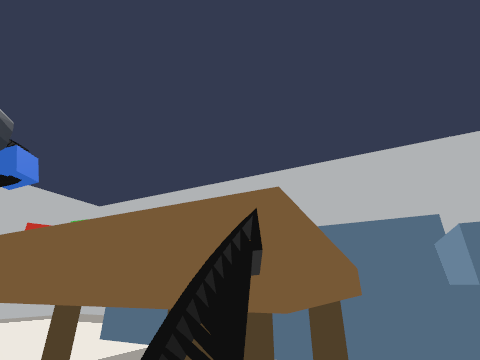
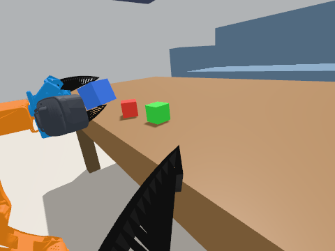

# Three-cube controller revision

Nano’s original controller completed all three floor-to-table transfers on 44 of 50 registered layouts. The six failures became development cases after their openings and measurements were disclosed. To check for regressions, we also selected six of the original successes, indices 0, 9, 18, 27, 36 and 45, before running the alternatives. An independent replay scored each candidate’s journal and checked its unique skill-bridge receipt. [Original results](../outcomes.md)

## What Nano can see before release

On layout 16, the head and spare wrist were below the tabletop when the base stopped. The controller could count zero earlier cubes from that posture. The two images show the same right wrist before the blue release. At tick 25,812 the table occluded the top surface. At tick 26,052 the wrist camera was 13.95 cm above the observed surface and detected both previous colors. The controller used onboard RGB, measured joint angles and the calibrated camera mount. Simulator object poses were available only to the independent evaluator.

| Docked right wrist | Raised right wrist |
| --- | --- |
|  |  |

The stationary-grasp plan with clearance enabled also succeeded on all three placement failures (16, 34 and 48) using the older wrist behavior. The new view provides direct occupancy evidence. The matched outcomes leave the effect of wrist elevation on placement success unresolved.

## Recover a missed grasp

In a controlled run of layout 20, the survey-only controller missed the green cube. With the same docking distance and a single additional wrist-based grasp attempt enabled, Nano observed a unique green candidate at tick 13,084 and completed all three transfers in 32,758 scored ticks with zero bypasses. The left wrist took the observation after the initial two misses. [Measured paired result](grasp-recovery-check.json)

## Inspect a development replay in Studio

In the offscreen Makepad test, an operator selected failure 16 from the verified original registration and ran the revised controller through the native Evidence page. The candidate completed all three transfers in 31,040 scored ticks with zero bypasses. Studio showed the same comparison after restart. The test verified both the candidate’s distinct receipt and the original verdict’s bytes. [Native screenshot](native-replay.png) · [Measured replay receipt](native-replay.json)

Signed Makepad DevHub job J16 also ran the native comparison on case 16 and reopened the result. Its prepared controller used the original runtime, stationary pickup and static wrist clearance. The job built the tested commit from its lease checkout and verified the executable digest again after the headless run. [Build and workflow manifest](../../../devhub/disclosed-layout/verification.json) · [Headless case receipt](../../../devhub/disclosed-layout/nano-case/verification.json)

On case 20, headless Studio also exercised the grasp recovery with the original docking distance. After restarting the app, selecting another failed case hid the previous result and reselecting case 20 restored its own result. [Native case-switching receipt](native-grasp-recovery.json)
