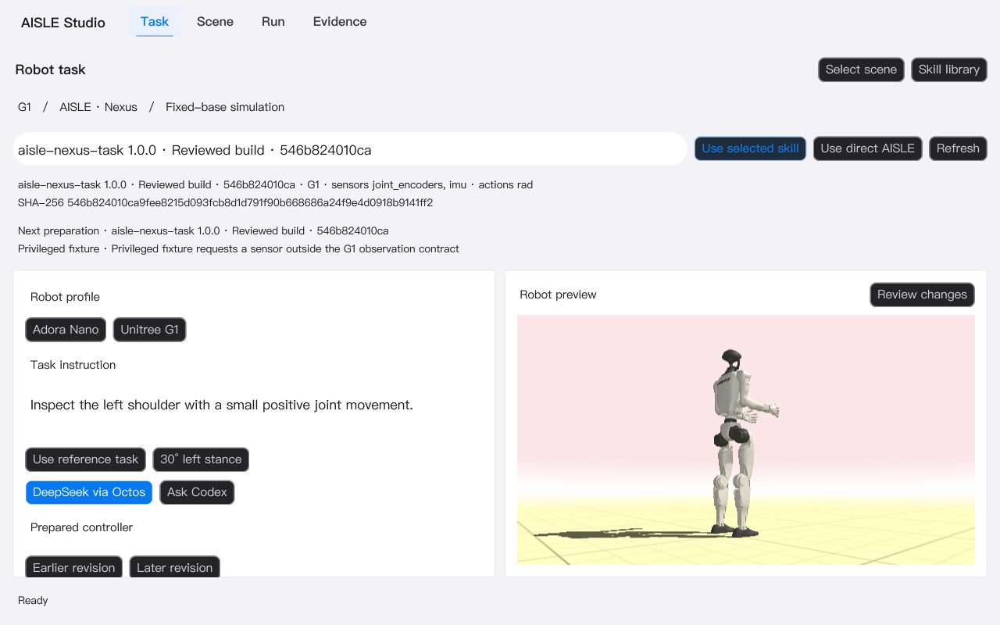

# Run an installed Octos skill on Nano or G1

**Task → Skill library** shows the installed sources for the selected robot. Two builds can share a name and version. Use the source label and SHA-256 to choose one, inspect its sensor inputs and action units, then select **Use selected skill**. The selection persists per robot. Prepare the controller through the usual reference, Codex or DeepSeek control. The Task page shows which package the prepared revision uses.

**Run → Start** invokes the selected package’s Octos app-skill entry point. For a scene-bound Nano pickup, Nexus runs the existing onboard-RGB and encoder controller. For a scene-bound G1 reach, it runs the standing controller using joint positions and orientation. **Use direct AISLE** returns subsequent preparations to the usual local execution path. An existing prepared revision keeps its original execution path.



## Set up the simulation bridge

Use the Studio and AISLE Python setup from the repository README. Install the pinned upstream bridge and matching Dora CLI in a separate environment if needed. The bridge graph runs on loopback. The vendor node uses the AISLE Python environment and the existing Nexus installation. [Studio setup](../../../../README.md#run-locally) · [Upstream bridge and wire protocol](https://github.com/dorarobotics/octos-dora-bridge/tree/d3a66e1956f9ab18369727cee5a3e9901700edd6/bridge)

```sh
uv venv --python 3.13 .venv-spec
uv pip install --python .venv-spec/bin/python \
  'octos-spec-bridge[runtime] @ git+https://github.com/dorarobotics/octos-dora-bridge.git@d3a66e1956f9ab18369727cee5a3e9901700edd6#subdirectory=bridge' \
  'dora-rs-cli==1.0.1'
uv pip install --python "$DOROBOT_AISLE_PYTHON" 'dora-rs==1.0.1'
export DOROBOT_SPEC_PYTHON="$PWD/.venv-spec/bin/python"
export DORA_BIN="$PWD/.venv-spec/bin/dora"
```

The Studio source is bundled under `skills/aisle-nexus-task`. To add another installed build, set `DOROBOT_SPEC_SOURCES` to a JSON file mapping a display name to its absolute package directory. Each directory must contain the Octos `manifest.json` and an executable `main`. Follow the bundled manifest for the supported robot profiles and task verb. Choose trusted installed software. The entry point runs as a local program under the Studio account. [Bundled manifest and entry point](../../../../skills/aisle-nexus-task)

```json
{"Reviewed build": "/absolute/path/to/installed/aisle-nexus-task"}
```

## What the run verifies

| Stage | Operator-visible result |
| --- | --- |
| Select and prepare | Studio hashes the package files, relative names and executable flags. The controller records its source, version, complete package digest, entry-point digest, robot, sensor contract and action units. It also pins the Studio simulation code, Nexus engine, AISLE backend and bridge module digests. |
| Launch | Studio rechecks the installed build, takes a private snapshot and invokes its `main run_task`. The entry point posts the controller identity, package identity, run ID and observation inputs to the upstream bridge’s `/tools/vendor.dorobot.aisle.task.run` endpoint. |
| Execute | The unmodified bridge creates a SPEC request ID and sends the command through Dora. The simulation node independently resolves the package and runtime, checks the command against the frozen trial, and calls the real AISLE/Nexus controller. It rejects an input outside the package contract before starting physics. |
| Inspect | Evidence retains the executed controller, node measurement and bridge receipt. Studio checks that the response has the request ID seen by the node and that its package, controller and measurement digests agree. The complete package directory is needed to reproduce its digest. |
| Device preflight | Studio checks the current installation, receipt and independently recorded simulation measurement again. The Nano adapter reports missing capabilities. G1 can replay recorded encoder and IMU samples over DDS and compare computed motor targets to the simulation. Physical qualification requires a supervised device run. |

The current vendor node runs the prepared task in Nexus. The upstream HTTP bridge and Dora command format are shared with deployed Octos app skills. A physical Nano or G1 vendor node still needs its own implementation identity, real measurements, calibration and operator-stop qualification. The package receipt describes the installed software and local execution. Hardware promotion and reviewer sign-off are separate release gates.

## Reproduce the native checks

The test installs two different implementations under one name and version, reopens the selected source, changes its executable after preparation and verifies that Run rejects it. It restores the selected executable and calls the deployment entry point. The test build first asks the node for simulator object poses, records the rejection, then sends the permitted request. During a separate active Nano pickup the operator presses **Stop** and the harness checks that both Dora process groups exited. The completed run opens in Evidence for a device preflight.

The G1 replay requires a Python environment with CycloneDDS and Unitree HG LowState support. Set `DOROBOT_G1_DDS_PYTHON` to its interpreter. Each test needs a fresh session directory. [G1 telemetry setup](https://github.com/dorobot-org/dorobot-studio/blob/e490c9f73ce2a6d63416880e33305cfbdcc50a2b/docs/product/aisle-studio/validation/device-preflight/README.md)

```sh
python3 tools/check_spec_skills.py --studio target/debug/aisle-studio \
  --remote "$(command -v makepad-remote)" --robot G1 --backend offscreen \
  --session /tmp/aisle-spec-g1
python3 tools/check_spec_skills.py --studio target/debug/aisle-studio \
  --remote "$(command -v makepad-remote)" --robot Nano --backend headless \
  --session /tmp/aisle-spec-nano
```

## Offscreen measurements

| Profile | Task through the selected package | Device preflight |
| --- | --- | --- |
| Nano | The red cube settled on the coffee table after 11,266 physics ticks. The wheels maintained support throughout. Nexus measured table contact for the final 100 ticks. Stopping an earlier pickup terminated both owned Dora process groups. | The installed base adapter reported missing arm, joint-feedback, head, camera and measured-odometry capabilities. The check sent zero motor commands. [Nano receipt](spec-verification/nano-offscreen.json) |
| G1 | The left-wrist reach finished 6.27 mm from its target within the 10 mm tolerance. Both feet stayed loaded for all 2,000 scored ticks. The torso impact met its recovery criterion. | Replaying 2,200 samples over loopback DDS reproduced all 29 computed joint targets at each step with zero maximum difference and zero motor commands. [G1 receipt](spec-verification/g1-offscreen.json) |

Signed Makepad DevHub job J12 ran both native workflows headlessly in 209 seconds. The installed package and all five runtime digests matched the offscreen runs. The Nano cube finished 120.2 mm inside the table edge after 11,266 physics ticks. G1 finished 6.27 mm from the wrist target and its dry run matched the Nexus targets exactly. These trials use reference controllers and the authored five-object living room. [Signed build manifest](devhub/spec-skills/verification.json) · [Nano headless receipt](devhub/spec-skills/nano/verification.json) · [G1 headless receipt](devhub/spec-skills/g1/verification.json)
